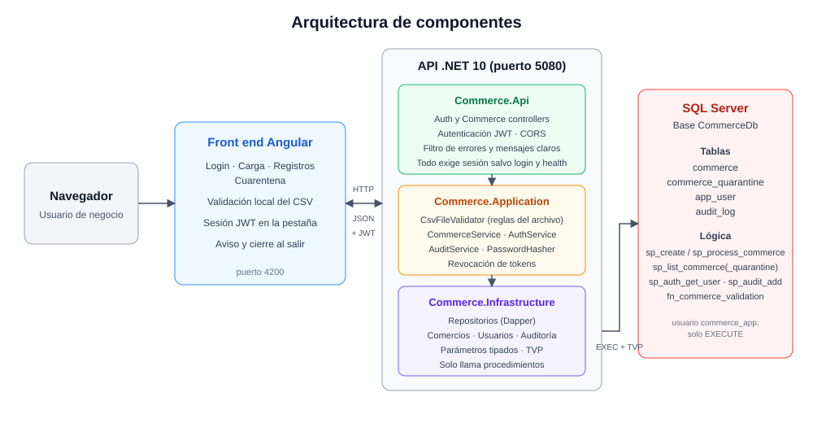
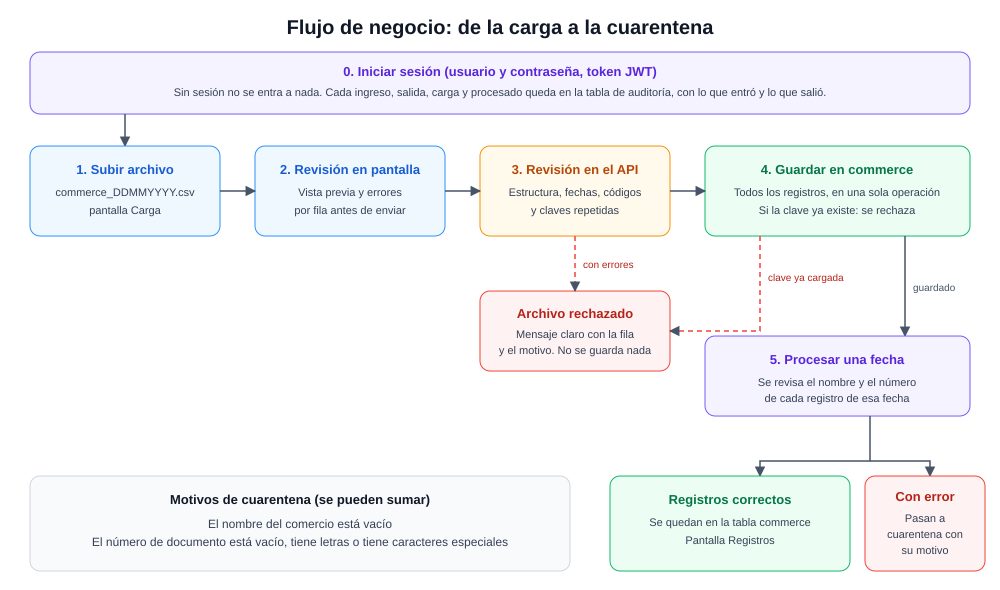
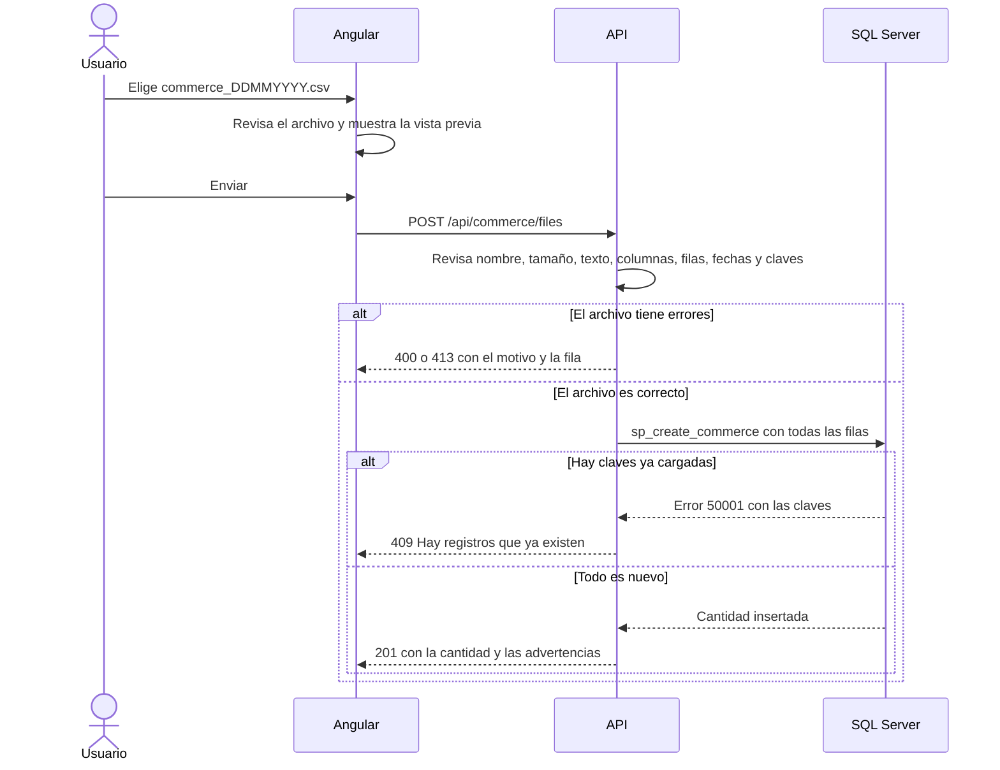
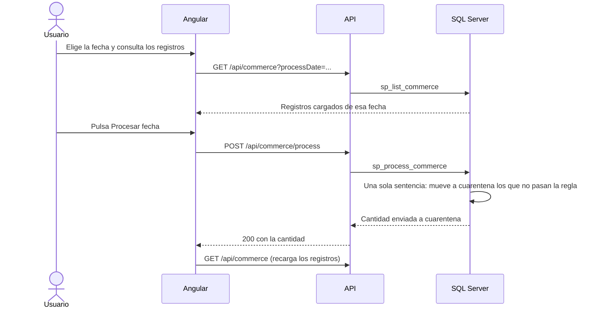
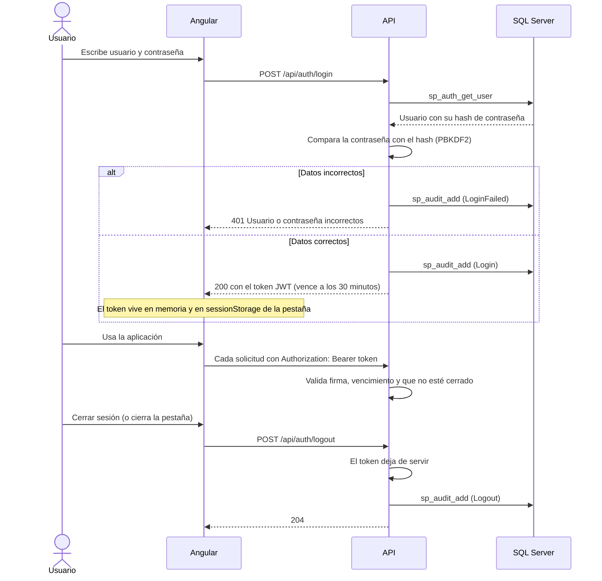

# Arquitectura

## Vista general

| Capa | Proyecto | Responsabilidad |
| --- | --- | --- |
| Pantallas | `frontend` (Angular) | Iniciar sesión, mostrar, revisar el archivo al instante y enviar. No decide: el API valida otra vez |
| Entrada | `Commerce.Api` | Recibir solicitudes, validar el token JWT, traducir errores a mensajes claros, CORS y arranque |
| Reglas | `Commerce.Application` | Revisar el archivo, leer el CSV, coordinar la carga y el proceso, iniciar y cerrar sesión, y registrar la auditoría |
| Datos | `Commerce.Infrastructure` | Llamar a los procedimientos con Dapper y parámetros tipados (comercios, usuarios y auditoría) |
| Base de datos | `CommerceDb` | Tablas, regla de validación y procedimientos |

Las dependencias van en un solo sentido: `Api → Application ← Infrastructure`. Application define la interfaz del
repositorio y no conoce SQL.

## Flujo de negocio

## Secuencia de la carga

## Secuencia del proceso por fecha

## Inicio y cierre de sesión

El token JWT lleva el número y el nombre del usuario, un identificador propio y la fecha de vencimiento. Está firmado con
HS256: si alguien lo modifica o lo fabrica con otra clave, el API lo rechaza.

### Qué pasa al cerrar la pestaña o el navegador

Una página web **no puede impedir** que el usuario cierre la pestaña o el navegador. Lo que sí hace la aplicación:

| Situación | Qué ocurre |
| --- | --- |
| Con una sesión abierta, el usuario intenta cerrar la pestaña, el navegador o recargar | El navegador muestra su propio aviso de confirmación (algunos navegadores lo muestran solo si el usuario ya interactuó con la página) |
| El usuario confirma y la página se va | La aplicación avisa al servidor (`POST /api/auth/closing`, con `keepalive` para que salga aunque la página se esté cerrando). El navegador no distingue cerrar de recargar en ese momento, así que el servidor espera 15 segundos antes de cerrar la sesión |
| La pestaña se cierra de verdad | Nadie cancela el aviso: pasados los 15 segundos el servidor revoca el token y registra `Logout` con motivo `pagehide` en la auditoría. El navegador ya borró el `sessionStorage` de esa pestaña, así que el token tampoco queda en el equipo |
| El navegador se cierra o falla de forma abrupta | Es el mismo caso: si el aviso salió, se audita a los 15 segundos. Si no salió (se cayó la red o se apagó el equipo), el token vence solo a los 30 minutos |
| El usuario pulsa **Cerrar sesión** | Se cierra en el servidor, se vacía la memoria de la página y se vuelve al inicio de sesión |
| El usuario recarga la página | La sesión continúa: la página recupera el token de `sessionStorage` y llama a `POST /api/auth/resume`, que cancela el cierre pendiente. Si ya pasaron los 15 segundos, el servidor responde 401 y se pide iniciar sesión |

### Una sola pestaña

Al arrancar, la aplicación pide al navegador un bloqueo con nombre (Web Locks). La primera pestaña lo obtiene y lo conserva
mientras esté abierta; el navegador lo libera solo al cerrarla. Otra pestaña o ventana del mismo navegador no lo obtiene y
muestra "La aplicación ya está abierta en otra pestaña", con un botón **Reintentar**. Esa pestaña no hace llamadas al API.

| Situación | Resultado |
| --- | --- |
| Abrir una segunda pestaña con el sistema | Aviso "La aplicación ya está abierta". No se puede iniciar sesión allí |
| Cerrar la primera pestaña y pulsar **Reintentar** en la segunda | Entra normalmente |
| Recargar la única pestaña | Entra normalmente (el bloqueo se libera al descargar la página) |
| Otro navegador, otro perfil, ventana privada u otro equipo | No lo cubre: es un control de la pantalla, no de seguridad. Para limitar sesiones por usuario haría falta controlarlo en el servidor (ver [mejoras.md](mejoras.md)) |
| Navegador muy antiguo sin Web Locks | La aplicación funciona, sin este control |

## Auditoría

Cada acción relevante deja una fila en `audit_log`. El registro lo hace la capa de reglas (no el controlador), así
también quedan las acciones que fallan, con el mismo código y el mismo mensaje que recibió el usuario.

| Acción | Cuándo | Qué entró (request) | Qué salió (response) |
| --- | --- | --- | --- |
| `Login` | Ingreso correcto | `{"username":"admin"}` | `{"success":true,"expiresAt":"..."}` |
| `LoginFailed` | Ingreso rechazado | `{"username":"admin"}` | `{"success":false,"reason":"wrong_password"}` |
| `Logout` | Salida | `{"reason":"manual"}` (botón) o `{"reason":"pagehide"}` (pestaña cerrada, lo registra el servidor tras 15 s) | `{"loggedOut":true}` |
| `Upload` | Carga de archivo | `{"fileName":"...","sizeBytes":495,"sha256":"..."}` | El resultado (201) o el error (400, 409, 413, 500) |
| `Process` | Procesado de fecha | `{"processDate":"2024-03-15"}` | `{"processDate":"...","quarantinedCount":5}` o el error |

- Nunca se guardan contraseñas, tokens ni el contenido del archivo: el archivo se identifica por nombre, tamaño y hash.
- Si no se puede guardar la auditoría, la operación del usuario sigue y el fallo se anota en el registro del servidor.
- Las consultas de pantalla (listar registros y cuarentena) no se auditan.

## Reenvío de información: recargar, doble clic y repetir

Pregunta frecuente: *cargo el archivo, recargo la página y se envía de nuevo*. **No ocurre**, por estas razones:

| Situación | Qué pasa | Por qué |
| --- | --- | --- |
| Recargar la página (F5) después de cargar | No se reenvía nada | El archivo viaja en una petición que hace la aplicación por detrás, no en el envío de un formulario del navegador. Al recargar, el navegador solo vuelve a pedir la página (`GET`), y no aparece el aviso "¿reenviar el formulario?" |
| Recargar y volver a entrar | La sesión continúa | El token está en `sessionStorage` y la página lo reanuda |
| Doble clic en Enviar | Una sola petición | El botón se deshabilita mientras se envía y la acción ignora un segundo clic (`exhaustMap`) |
| Enviar el mismo archivo otra vez a propósito | Se rechaza con 409 | Las claves ya existen y el índice único lo impide, incluso si dos envíos llegan a la vez |
| Procesar la misma fecha otra vez | Responde 0 y no cambia nada | Los registros ya se movieron |
| Botones atrás y adelante del navegador | No envían nada | La aplicación cambia de pantalla sin hacer peticiones de carga |

Queda como mejora el encabezado `Idempotency-Key`, para reintentar con seguridad cuando una carga se corta por la red
(ver [mejoras.md](mejoras.md)).

## Patrones y buenas prácticas aplicadas

| Práctica | Dónde |
| --- | --- |
| Separación en capas con dependencias hacia el centro | Soluciones `Api`, `Application`, `Infrastructure` |
| Validar en ambos lados: el front avisa, el API decide | `csv-validation.ts` y `CsvFileValidator` |
| Errores con formato estándar (ProblemDetails) y mensajes claros | `ApiExceptionFilter`, `GlobalExceptionHandler` |
| Sin SQL armado a mano: solo procedimientos con parámetros | `CommerceRepository` |
| Operación atómica: todo o nada | `sp_create_commerce`, `sp_process_commerce` |
| Mínimo privilegio | Usuario `commerce_app` con solo EXECUTE |
| Autenticación con token firmado y de corta duración | JWT HS256 de 30 minutos, cerrado en el servidor al salir |
| Contraseñas con hash lento y sal | PBKDF2-SHA256, 600.000 iteraciones, comparación en tiempo constante |
| Mensajes de ingreso sin pistas | Mismo texto para usuario inexistente y contraseña errónea |
| Trazabilidad | Tabla de auditoría con entrada y salida de cada acción |
| Secretos fuera del código | La clave de firma no tiene valor por defecto: fuera de desarrollo debe venir de la configuración |
| Configuración fuera del código | `appsettings.json`, `environment.ts` |
| Cancelación de extremo a extremo | Botón Cancelar y `CancellationToken` hasta la base |
| Reproducible | `global.json`, `.nvmrc`, versiones exactas, `.gitattributes` |

## Seguridad: ¿qué pasa si el archivo trae SQL malicioso?

Nada. El contenido del archivo es **dato**, nunca se convierte en una instrucción. Hay tres barreras:

1. **El lector de CSV** solo separa campos. No interpreta el texto.
2. **El repositorio** envía las filas como una tabla con parámetros tipados (`dbo.CommerceTableType`) a un procedimiento.
   No existe ninguna instrucción SQL armada con texto del archivo.
3. **El usuario de la base de datos** (`commerce_app`) solo puede ejecutar procedimientos. Aunque algo fallara, no podría borrar ni alterar tablas.

Se comprobó con el archivo [`injection-attempt/commerce_22032024.csv`](../backend/database/samples/injection-attempt/commerce_22032024.csv),
que trae en los nombres textos como `Robert'); DROP TABLE dbo.commerce;--` y `' OR 1=1; DELETE FROM ...`:

| Contenido del archivo | Resultado |
| --- | --- |
| `Robert'); DROP TABLE dbo.commerce;--` como nombre | Se guarda como texto. La tabla sigue existiendo |
| `' OR 1=1; DELETE FROM dbo.commerce_quarantine;--` como nombre | Se guarda como texto. La cuarentena no se borra |
| `` como nombre | Se guarda como texto. La pantalla lo muestra escapado, no lo ejecuta |
| `0944';DROP TABLE x;--` como número | Al procesar su fecha va a cuarentena con los motivos "contiene letras" y "caracteres especiales" |
| `=HYPERLINK(...)` como nombre | Se guarda como texto (ver la mejora de exportación segura en [mejoras.md](mejoras.md)) |

Otros controles de entrada: tamaño máximo, número máximo de filas, longitud por columna, texto UTF-8 válido y sin bytes
nulos. El nombre que envía el cliente nunca se usa como ruta, porque el archivo no se guarda en disco.
