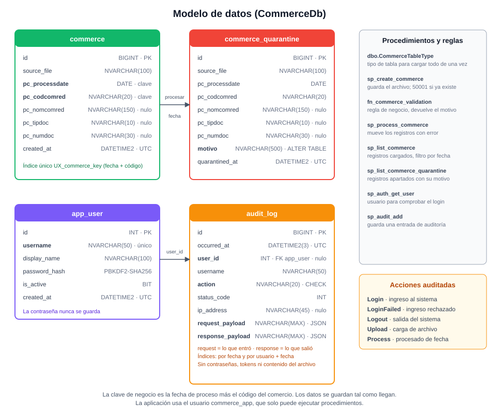

# Base de datos

Motor: SQL Server 2017 o superior. Base: `CommerceDb`.



El detalle de cada columna, tipo, formato y ejemplo está en el [diccionario de datos](diccionario-datos.md).

## Scripts

Se ejecutan en este orden. Todos se pueden repetir sin error.

| Orden | Archivo | Se conecta a | Contenido |
| --- | --- | --- | --- |
| 1 | `backend/database/01_create_database.sql` | `master` | Base `CommerceDb` y login `commerce_app` |
| 2 | `backend/database/02_schema.sql` | `CommerceDb` | Tablas, columna `motivo`, tipo de tabla, función, procedimientos, usuario de la aplicación, y las tablas de usuarios y auditoría con dos usuarios de desarrollo |
| 3 | `backend/database/seed.sql` | `CommerceDb` | Opcional. Carga el archivo base directo en la tabla |
| 4 | `backend/database/tests.sql` | `CommerceDb` | Opcional. Pruebas con rollback: no dejan datos |

## Tablas

**`commerce`**: registros cargados. Después de procesar una fecha, quedan solo los que pasaron la regla de validación.

| Columna | Tipo | Notas |
| --- | --- | --- |
| `id` | BIGINT | Clave primaria, autonumérica |
| `source_file` | NVARCHAR(100) | Archivo de origen |
| `pc_processdate` | DATE | Parte de la clave de negocio |
| `pc_codcomred` | NVARCHAR(20) | Parte de la clave de negocio |
| `pc_nomcomred` | NVARCHAR(150) | Nulo permitido: se guarda lo que llega |
| `pc_tipdoc` | NVARCHAR(10) | Nulo permitido |
| `pc_numdoc` | NVARCHAR(30) | Texto, no número: los valores con letras deben poder llegar a la cuarentena |
| `created_at` | DATETIME2(0) | Hora UTC de carga |

Índice único `UX_commerce_key (pc_processdate, pc_codcomred)`: impide claves repetidas aunque dos cargas coincidan.

**`commerce_quarantine`**: registros apartados al procesar una fecha. Mismas columnas de negocio, más `motivo`
(NVARCHAR(500), agregado con `ALTER TABLE` en su propia sección del script) y `quarantined_at`. Índice
`IX_quarantine_processdate`.

**`app_user`**: personas que pueden iniciar sesión. Tiene el nombre de usuario (único, sin distinguir mayúsculas), el
nombre para mostrar, el hash de la contraseña (`PBKDF2-SHA256$iteraciones$sal$hash`) y si está activo. La contraseña
nunca se guarda.

**`audit_log`**: una fila por acción de un usuario (`Login`, `LoginFailed`, `Logout`, `Upload`, `Process`) con la hora UTC,
el usuario (`user_id` es nulo cuando el nombre no existe), la dirección, el código de respuesta y dos campos JSON:
`request_payload` (lo que entró) y `response_payload` (lo que salió). La columna `action` tiene una restricción que solo
admite esos cinco valores. Índices por fecha y por usuario más fecha.

## Regla de validación

`dbo.fn_commerce_validation(nombre, numero)` devuelve el motivo, o `NULL` si el registro es correcto.
Es la única fuente de la regla: la usa `sp_process_commerce` para decidir qué registros se apartan.

| Condición | Motivo |
| --- | --- |
| Nombre vacío | El nombre del comercio (nomcomred) se encuentra vacío |
| Número vacío | El número (numdoc) se encuentra vacío |
| Número con letras | El número (numdoc) contiene letras |
| Número con caracteres especiales | El número (numdoc) contiene caracteres especiales |

Si hay varios, se unen con `; `.

## Procedimientos

| Procedimiento | Entrada | Salida |
| --- | --- | --- |
| `sp_create_commerce` | `@SourceFile`, `@Rows` (`dbo.CommerceTableType`) | `InsertedCount`. Guarda todas las filas en `commerce`. Si una clave ya existe, error 50001 con hasta 20 claves |
| `sp_process_commerce` | `@ProcessDate` | `QuarantinedCount`. Valida los registros de la fecha con la función y mueve a cuarentena los que fallan en una sola sentencia (`DELETE ... OUTPUT ... INTO`) |
| `sp_list_commerce` | `@ProcessDate` (opcional) | Registros de `commerce`, hasta 5000, más recientes primero |
| `sp_list_commerce_quarantine` | `@ProcessDate` (opcional) | Registros en cuarentena con su motivo, hasta 5000 |
| `sp_auth_get_user` | `@Username` | El usuario (`Id`, `Username`, `DisplayName`, `PasswordHash`, `IsActive`), o ninguna fila. La API compara la contraseña con el hash |
| `sp_audit_add` | `@UserId` (opcional), `@Username`, `@Action`, `@StatusCode`, `@IpAddress`, `@RequestPayload`, `@ResponsePayload` | Guarda una fila de auditoría. Falla si la acción no es una de las cinco permitidas |

Todos usan `SET NOCOUNT ON; SET XACT_ABORT ON;`, columnas explícitas y ningún SQL dinámico.
La validación de negocio vive en SQL (en `sp_process_commerce`), como pide el enunciado.

## Usuarios de desarrollo

`02_schema.sql` crea dos usuarios de aplicación para poder iniciar sesión (solo desarrollo, ver [SECURITY.md](../SECURITY.md)):

| Usuario | Contraseña |
| --- | --- |
| `admin` | `Admin#2026` |
| `analista` | `Analista#2026` |

## Consultar la auditoría

La auditoría se consulta en la base de datos, con un usuario administrador (el usuario `commerce_app` no puede leer tablas).

```sql
-- Últimas acciones
SELECT TOP (50) id, occurred_at, username, action, status_code, ip_address
FROM dbo.audit_log
ORDER BY id DESC;

-- Lo que hizo un usuario, con lo que entró y lo que salió
SELECT occurred_at, action, status_code, request_payload, response_payload
FROM dbo.audit_log
WHERE username = N'admin'
ORDER BY id;

-- Ingresos rechazados
SELECT occurred_at, username, ip_address, response_payload
FROM dbo.audit_log
WHERE action = N'LoginFailed'
ORDER BY id DESC;
```

## Usuario de la aplicación

`commerce_app` solo tiene `EXECUTE` sobre el esquema `dbo` y sobre el tipo `CommerceTableType`. Eso cubre también los procedimientos de usuarios y auditoría.
No puede leer ni modificar las tablas directamente. Para consultar datos use un usuario administrador.

## Pruebas de la base de datos

`tests.sql` verifica, dentro de transacciones que se revierten:

1. Cargar 10 registros y procesarlos deja 5 en cuarentena. La fila con tres fallas tiene tres motivos. Procesar de nuevo da 0.
2. La función devuelve `NULL` en un registro correcto y un motivo en los incorrectos.
3. Cargar una clave existente falla con el error 50001.
4. La columna `motivo` existe.
5. La consulta de registros muestra lo cargado antes de procesar y solo los correctos después.
6. Existe el usuario `admin` con un hash PBKDF2, un usuario inexistente no devuelve filas, y la auditoría guarda el usuario, la acción y los dos JSON.
7. Una acción de auditoría desconocida y un nombre de usuario repetido (sin distinguir mayúsculas) se rechazan.
